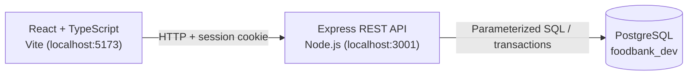

# Food Bank Booking System — Unofficial Full-Stack Prototype

[](https://github.com/BReaney/Food-Bank-System/actions/workflows/build.yml)

A full-stack appointment-booking and staff-management application built with **React, TypeScript, Express, and PostgreSQL**. Students using fictional demonstration accounts can manage their eligibility, household information, and appointments; fictional staff accounts can configure schedules, review requests, inspect records, and produce usage reports.

> **Independent project / non-affiliation disclaimer:** This project was created **solely for personal development, learning, and software-development portfolio purposes**. It is **NOT affiliated with, sponsored by, endorsed by, or operated by the University of Victoria (UVic) or the University of Victoria Students' Society (UVSS)**. References to those organizations describe the inspiration and hypothetical requirements only. **This is not an official food bank service.** Do not enter real student or client information.

**Status:** Functional, locally run **portfolio prototype** using fictional data. It is **not production-ready** and has not been authorized for use by UVic, UVSS, or any food bank.

## Contents

- [Features](#features)
- [Technology stack](#technology-stack)
- [Architecture](#architecture)
- [Run locally](#run-locally)
- [How to use the demo](#how-to-use-the-demo)
- [Testing and results](#testing-and-results)
- [Repository structure](#repository-structure)
- [Known limitations and security](#known-limitations-and-security)
- [Documentation](#documentation)

## Features

### Student-facing

| Feature | What it does |
|---|---|
| Account and profile | Register/sign in with a **fictional** example-domain address; edit your name, domestic/international designation, and selected dietary preferences; sign out |
| Term eligibility | Complete a demonstration eligibility survey and view staff enrollment-verification status by term |
| Weekly appointment calendar | Inspect staff-defined slots and availability; book no more than once per Vancouver-local week, subject to minimum notice and capacity |
| Appointment management | View upcoming appointments and history, cancel or reschedule eligible reservations |
| Dependents and pickup contacts | Request dependent approval; add, edit, and remove third-party pickup contacts with explicit demonstration consent |
| In-app notifications | See persisted booking, cancellation, rescheduling, and staff schedule-change notices; mark individual or all messages read |
| Page navigation | Move between dedicated appointments, eligibility, household, notifications, and profile pages |

### Staff-facing

| Feature | What it does |
|---|---|
| Term and slot calendars | Create terms, configure time windows/capacity, generate slots, and edit or close booked slots |
| Enrollment verification | Search students and mark term enrollment pending, verified, or rejected |
| Household approvals | Confirm or deny dependent and third-party pickup requests |
| Appointment roster | Review reservations and record completed pickups or no-shows |
| Unified student records | Search student profiles; see domestic/international designation and dietary restrictions in results and individual records, alongside term, household, appointment and event histories |
| Usage reporting | Generate aggregated term/date-range reports, including booked/completed/missed/cancelled counts, and export CSV |
| Audit history | Store selected staff decisions and record-access actions without putting private consent or survey answers into audit JSON |

**Important:** The system uses sample survey questions, fictional student/staff identities, and **in-app** notices only. It does **not** perform real university authentication, enrollment verification, food inventory tracking, or email/SMS delivery.

## Technology stack

| Layer | Tools | Role |
|---|---|---|
| Frontend | React 19, TypeScript, Vite 8, CSS | Role-specific pages, forms, interactive weekly calendar |
| Backend | Node.js, Express 5, TypeScript | REST APIs, role/ownership checks, business rules, PostgreSQL transactions |
| Database | PostgreSQL (CI uses PostgreSQL 17) | Profiles, sessions, eligibility, appointments, households, events, notifications, audit logs |
| Authentication | Local demo-only password + session implementation | Scrypt-hashed passwords, HTTP-only session cookies, server-side authorization |
| Tests | Node test runner, TypeScript integration scripts | Regression checks and **36 new RSD-tagged acceptance cases** |
| CI | GitHub Actions | Full-stack builds and automated tests against a disposable PostgreSQL database |

## Architecture



The frontend never connects directly to the database. Express validates the signed-in account and permissions; PostgreSQL persists records, provides referential constraints, and supports transactional booking and notification updates.

See [Architecture and data flows](docs/architecture.md) for more detail.

## Run locally

These instructions are for a **new checkout and a new, empty local database**. They have been aligned to the repository's current scripts and migrations. The commands work with PowerShell on Windows; macOS/Linux equivalents are noted where needed.

### Prerequisites

- **Git** — to clone the repository.
- **Node.js 24** and npm — matches the GitHub Actions build environment.
- **PostgreSQL 17** (or a compatible recent release) and either **pgAdmin 4** or the `psql` command-line client.
- A local development computer. Ports **5432** (PostgreSQL), **3001** (Express), and **5173** (Vite) should be available.

No production hosting or third-party accounts are required.

### 1. Clone and install dependencies

```powershell
git clone https://github.com/BReaney/Food-Bank-System.git
cd Food-Bank-System

cd backend
npm ci

cd ../frontend
npm ci

cd ..
```

There are two npm projects, so their dependencies are installed separately. `npm ci` uses each folder's committed lockfile.

### 2. Create an empty local PostgreSQL database

Open **pgAdmin** and connect to your local PostgreSQL server as the administrator (usually `postgres`). In the Query Tool connected to the **postgres** maintenance database, run:

```sql
CREATE ROLE foodbank_app WITH LOGIN PASSWORD 'REPLACE_WITH_A_STRONG_LOCAL_PASSWORD';
```

Execute the next statement **separately** (not inside a multi-statement transaction):

```sql
CREATE DATABASE foodbank_dev OWNER foodbank_app;
```

Use a strong password of your own and keep it private. If the role or database already exists, **do not recreate it**. Instead follow the existing-database instructions in [Database setup](database/README.md).

In pgAdmin register a local connection with **Host:** `localhost`, **Port:** `5432`, **Maintenance database:** `foodbank_dev`, **User:** `foodbank_app` and the password chosen above. Run the following migrations as this application user.

### 3. Apply database migrations, in order

From the **repository root** in PowerShell:

```powershell
psql -h localhost -U foodbank_app -d foodbank_dev -v ON_ERROR_STOP=1 -f database/migrations/001_core.sql
psql -h localhost -U foodbank_app -d foodbank_dev -v ON_ERROR_STOP=1 -f database/migrations/002_auth.sql
psql -h localhost -U foodbank_app -d foodbank_dev -v ON_ERROR_STOP=1 -f database/migrations/003_enrollment_history.sql
psql -h localhost -U foodbank_app -d foodbank_dev -v ON_ERROR_STOP=1 -f database/migrations/004_household_pickups.sql
psql -h localhost -U foodbank_app -d foodbank_dev -v ON_ERROR_STOP=1 -f database/migrations/005_staff_calendar.sql
psql -h localhost -U foodbank_app -d foodbank_dev -v ON_ERROR_STOP=1 -f database/migrations/006_booking_notifications.sql
psql -h localhost -U foodbank_app -d foodbank_dev -v ON_ERROR_STOP=1 -f database/migrations/007_student_profile_preferences.sql
```

If `psql` is unavailable, open **each SQL file in order** using pgAdmin's Query Tool connected as `foodbank_app` to `foodbank_dev`, and execute it once.

**Migrations 001–007 are one-time migrations for a new database. Do not re-run them against an existing configured database.** No migration runner is installed.

### 4. Load fictional sample records

From the repository root:

```powershell
psql -h localhost -U foodbank_app -d foodbank_dev -v ON_ERROR_STOP=1 -f database/seed/demo.sql
```

Or run `database/seed/demo.sql` in pgAdmin. This provides a demonstration term and sample appointment slot. It contains **only fictional sample records**.

### 5. Configure the private backend environment

From the repository root in **PowerShell**:

```powershell
Copy-Item backend/.env.example backend/.env
```

On macOS/Linux use `cp backend/.env.example backend/.env`.

Open `backend/.env` in your editor. Replace `PGPASSWORD` with your own local `foodbank_app` password; set **two different strong passwords (12–128 characters)** for `DEMO_STAFF_PASSWORD` and `DEMO_STUDENT_PASSWORD`. Keep:

```dotenv
PGHOST=localhost
PGPORT=5432
PGDATABASE=foodbank_dev
PGUSER=foodbank_app
PGPASSWORD=YOUR_PRIVATE_LOCAL_DATABASE_PASSWORD

ENABLE_PROTOTYPE_AUTH=true
FRONTEND_ORIGIN=http://localhost:5173

DEMO_STAFF_PASSWORD=YOUR_PRIVATE_FICTIONAL_STAFF_PASSWORD
DEMO_STUDENT_PASSWORD=YOUR_DIFFERENT_FICTIONAL_STUDENT_PASSWORD
```

**Never commit `backend/.env` or real passwords.** The real file is ignored by Git; `backend/.env.example` is the safe template.

### 6. Provision the fictional logins

In a terminal at the repository root:

```powershell
cd backend
npm run seed:demo-accounts
cd ..
```

This provisions local, fictional authentication credentials for:

| Role | Demo email | Password |
|---|---|---|
| Staff | `staff.demo@example.com` | Your `DEMO_STAFF_PASSWORD` |
| Student | `alex.demo@example.com` | Your `DEMO_STUDENT_PASSWORD` |

**Note:** Rerunning this provisioning command **resets both demo passwords** to the current `.env` values. It does not erase their appointment histories.

### 7. Run the application

Start each server in a **separate terminal**, starting from the repository root:

**Terminal A — API**

```powershell
cd backend
npm run dev
```

**Terminal B — Web application**

```powershell
cd frontend
npm run dev
```

Open **http://localhost:5173** in your browser.

- **Frontend:** http://localhost:5173
- **API health:** http://localhost:3001/api/health
- **Database health (local only):** http://localhost:3001/api/db-health

Do not expect a website at `http://localhost:3001/`; port 3001 serves the JSON API.

## How to use the demo

1. Sign in as `staff.demo@example.com`. Open **Calendar & slots** to inspect the demonstration term and create additional slots when needed.
2. Sign out and sign in as `alex.demo@example.com`, or use **Create a student profile** with a fictional `@example.test` address.
3. Student pages include **Book & manage appointments**, **Eligibility & enrollment**, **Dependents & pickup contacts**, **Notifications**, and **My profile**.
4. New students choose their domestic/international designation and dietary restrictions (or explicitly **None**) during registration. Existing accounts can fill in these fields through **My profile**.
5. Newly registered fictional students must submit the term survey and be **verified by staff** before booking. The pre-seeded Alex account has demo-term verification data.
6. Use an eligible available appointment slot, inspect the private confirmation, and test cancellation or rescheduling before the configured cutoff.
7. Sign back in as staff to review **Appointment roster**, **Enrollment verification**, **Household approvals**, **Student records**, and **Usage reports**.

The app uses **America/Vancouver** for appointment scheduling and local booking-week rules. You may need to create slots on the staff calendar if the demonstration slot has become unavailable.

## Testing and results

The repository includes both pre-existing regression suites and a dedicated RSD acceptance package:

- [Readable test results](testing/test-results.md) — records a verified CI run with **36/36 added acceptance cases passing**, plus the existing integration suites.
- [RSD requirements-to-test traceability matrix](testing/requirements-matrix.md) — all 26 functional and 12 nonfunctional RSD requirements, linked to test groups.
- [Testing guide](testing/README.md) — details the suite, execution reports, manual checks, and intentional deferrals.
- [GitHub Actions](https://github.com/BReaney/Food-Bank-System/actions/workflows/build.yml) — builds both applications and tests against a **disposable** PostgreSQL service.

For an extra local check, **keep your backend running**, and from `backend/` execute:

```powershell
npm run build
npm run test:acceptance
```

From `frontend/`:

```powershell
npm run build
npm run test:navigation
npm run test:calendar-state
```

Acceptance tests create and clean up **fictional** local fixture records. **Do not run `npm run test:db-setup` on your own persistent database:** that script is only for the disposable CI fixture. See the testing guide before running the full suite.

## Repository structure

```text
Food-Bank-System/
├── .github/workflows/      # Full-stack build and test automation
├── backend/
│   ├── src/routes/         # Express API endpoints
│   ├── src/security/       # Demo sessions, passwords, role checks
│   ├── src/utils/          # Booking/pickup/notification helpers
│   ├── src/scripts/        # Seed tools and existing smoke tests
│   └── .env.example        # Safe local configuration template
├── frontend/
│   ├── src/                # React pages, feature components, CSS, calendar
│   └── tests/              # Existing UI logic/navigation tests
├── database/
│   ├── migrations/         # Ordered schema migrations 001–007
│   └── seed/               # Fictional sample data
├── docs/                   # Current architecture + historical milestone notes
├── testing/
│   ├── integration/        # 36 acceptance scenarios
│   ├── results/            # Generated local/CI result files (not committed)
│   ├── requirements-matrix.md
│   └── test-results.md     # Verified, committed result snapshot
└── README.md
```

## Known limitations and security

This is a **local-only, fictional-data** prototype. In particular:

- No verification of actual UVic email ownership or student/staff identity; local demo accounts use example domains only.
- Student designation and dietary selections remain unspecified for legacy accounts until entered. These are self-reported fictional fields, visible only to the student and authorized staff in **Unified Staff Records**; they are **not** used for booking eligibility or exported in usage reports.
- Staff manually decide enrollment and household approvals. The sample survey and consent wording are not an approved organizational policy.
- Notifications exist **inside the application**, not via email, SMS, or push.
- No integration with student records, payments, food inventory, or external identity providers.
- No production authorization, privacy-policy approval, operational uptime or security review.
- The RSD's 1,100-account performance target, 10 simultaneous bookings and strict response-time benchmarks have **not** been formally verified at scale.

The backend deliberately disables protected prototype APIs outside its configured localhost development gate or when `NODE_ENV=production`. **Do not bypass that gate to make this project publicly accessible. Do not use real student information.**

More details: [Architecture](docs/architecture.md) · [Data setup](database/README.md) · [Test coverage and deferred cases](testing/requirements-matrix.md).

### Common setup issues

| Symptom | What to check |
|---|---|
| `psql` is not recognized | Use pgAdmin Query Tool instead, or add PostgreSQL's `bin` folder to your PATH |
| `CREATE DATABASE cannot run inside a transaction block` | Run `CREATE ROLE` and `CREATE DATABASE` in **separate** Query Tool executions |
| Database health responds `status: error` | Check PostgreSQL is running and `PGHOST`, `PGUSER`, `PGDATABASE`, `PGPASSWORD` in `backend/.env` |
| `password authentication failed` (PostgreSQL 28P01) | Check that the app user's database password matches `PGPASSWORD` |
| Protected API responds `404` | Check `ENABLE_PROTOTYPE_AUTH=true`, local access, and that `NODE_ENV` is not `production` |
| Sign-in fails | Rerun `npm run seed:demo-accounts` **from `backend/`** if credentials were never provisioned; note it resets demo passwords |
| No appointment slots available | Use the staff calendar to create future slots within an active term, and confirm student enrollment/survey eligibility |

## Documentation

See [Documentation index](docs/README.md) for architecture, authentication, appointments, staff calendar, household approvals, notifications, reporting, records, and the historical implementation notes.

---

**Unaffiliated educational portfolio project. Not an official UVic or UVSS application. Not intended for real student data or public deployment.**
