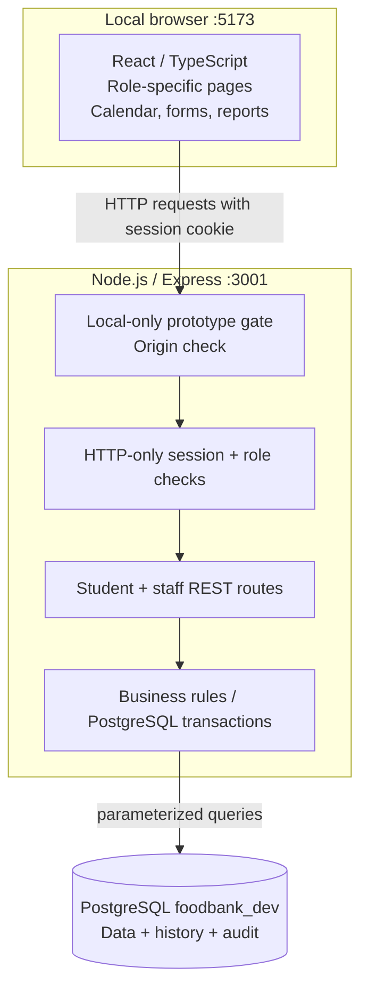
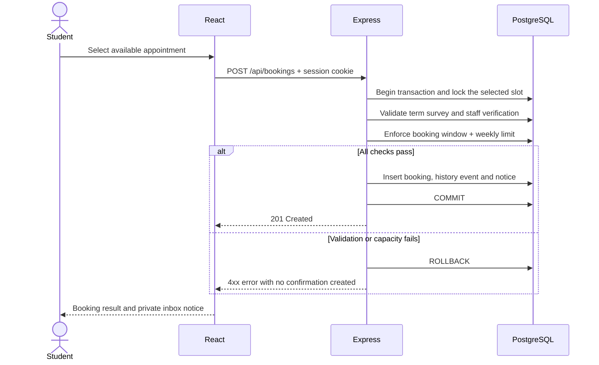

# System architecture and data flows

**Project:** Food Bank Booking System — unofficial portfolio prototype  
**Source of truth:** Current implementation on `main`, the [root README](../README.md), and executable acceptance tests.

> **Independent personal-development project:** Not affiliated with, sponsored by, or endorsed by the University of Victoria (UVic) or the University of Victoria Students' Society (UVSS). Fictional records only; not an official service or a production security reference.

## High-level design

- **Frontend:** `frontend/src/App.tsx` composes existing role-specific feature screens. `pageNavigation.ts` selects a page from the URL hash; this hides unrelated UI, but **does not authorize access**.
- **Backend:** `backend/src/index.ts` mounts the route modules. `backend/src/security/sessions.ts` resolves the active session from an HTTP-only cookie and enforces staff/student roles. Each route checks the required ownership and operation rules server-side.
- **Database:** `backend/src/db.ts` creates the connection pool from the private local `backend/.env`. The schema is built by migrations `001_core.sql` through `007_student_profile_preferences.sql`.
- **Time:** Appointments and booking weeks are interpreted in `America/Vancouver`, including daylight-saving changes.
- **Runtime boundaries:** The prototype only permits protected API routes in a configured **local, non-production** environment. Do not change these checks to make a public demo without an independent security/privacy review.

## Authentication and authorization

1. The developer provisions the fictional staff and student accounts through `npm run seed:demo-accounts` using private passwords configured in `backend/.env`.
2. A fictional student can register with an example-domain address. Public registration **cannot create staff accounts**.
3. Passwords are stored as salted scrypt hashes in PostgreSQL; raw session tokens are stored only in HTTP-only cookies, with token hashes in the DB.
4. Express resolves the signed-in profile before accessing private student data or staff management endpoints. **Student ID comes from the session, not arbitrary browser parameters.**
5. The **Origin** check and local-only gate provide limited developer-machine safeguards. They are not a substitute for a production authentication and web-security architecture.

Reference: [Authentication and profiles](authentication-and-profiles.md).

## Major data domains

| Domain | Main tables/views | Why it exists |
|---|---|---|
| Profiles and sessions | `profiles`, `auth_credentials`, `auth_sessions` | Fictional account identity, domestic/international designation, dietary preferences, and demo role separation |
| Terms and eligibility | `terms`, `enrollment_verifications`, `eligibility_surveys`, `enrollment_verification_events` | Separate survey and staff verification, per term |
| Appointment scheduling | `appointment_slots`, `slot_availability`, `bookings`, `booking_events` | Slots, capacity, one-per-week rules, immutable history |
| Household approvals | `dependent_requests`, `pickup_contacts`, `household_events` | Confirmed dependents, consented pickup contacts, approvals and change history |
| Notifications | `student_notifications` | Persisted student-owned confirmation and staff slot notices |
| Audit and reporting | `audit_logs` and aggregate queries over existing tables | Staff-action accountability and anonymized/aggregated usage reporting |

Schema migrations and seed files: [database/](../database/README.md).

## Student booking flow

- The booking logic lives in `backend/src/routes/bookings.ts` and `bookingManagement.ts`.
- Slot capacity and one noncancelled booking per student per Vancouver-local week are enforced server-side and by supporting database constraints.
- Booking-created, cancelled, or rescheduled notices are written **in the same transaction** as the booking mutation.
- Cancelling frees the relevant slot and changes the booking status but retains history.
- Staff changes to an occupied slot are handled by the staff calendar API and generate appropriate private notices.

## Eligibility and pickup permissions

**Survey versus enrollment:** A student's self-attested fictional survey is **not enrollment verification**. Both are required for eligible booking, and they are evaluated for each specific term. Staff approval is a manual local-demo action, not a university enrollment lookup.

**Dependents and contacts:** Students request household records, provide explicit third-party pickup consent, and wait for staff confirmation. The booking API checks that the selected pickup identity is approved and belongs to the booking student. Editing or withdrawing a contact can invalidate upcoming pickup assignments while retaining the appointment.

See [Eligibility](eligibility-and-enrollment.md) and [Dependents/pickup contacts](dependents-third-party-pickups.md).

## Staff workflows and reports

- The **staff calendar** defines terms, appointment windows, slot capacity, and closures.
- The **roster** records completed or no-show outcomes, which remain visible in student appointment history.
- The **unified records menu** searches students and displays their current household details, enrollment/eligibility history and paginated appointment history. Student records and search requests are staff-only and audited.
- **Usage reporting** aggregates booked, completed, missed, and cancelled statuses by term/date, with CSV export. Reports do **not** contain individualized survey needs or contact details.

## Verification and intentional limitations

The repo contains [36 additional API/database acceptance checks](../testing/README.md), existing backend smoke tests, and frontend calendar/navigation tests. Their mapping to the project's RSD and the latest CI evidence are available in [the traceability matrix](../testing/requirements-matrix.md) and [test results](../testing/test-results.md).

The implementation does not prove real university identity, final consent/policy requirements, 1,100-user load, 10-client simultaneous booking stress, desktop/mobile accessibility, real email/SMS delivery, operational uptime, or production-readiness. Refer to the above records for verified versus deferred requirements.
